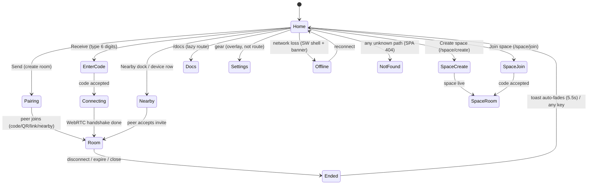

# APP-MAP (P0, STEP 3)

Generated tables come from `scripts/audit-imports.mjs` (§b) and
`scripts/audit-tokens.mjs` (§c); `scripts/_audit-text.mjs` and
`scripts/_audit-hardcoded.mjs` produced §d. Gate runs (§e) are one
run per suite against the servers noted. Tree: main @ d16baaa+.

## a. Screens

| Screen | file:line | how you get there | how you leave | state it needs |
|---|---|---|---|---|
| Home (landing = app) | src/views/SingleScreenApp.tsx:327 (App), :76 PanelMode `idle` | `/` load | never left (overlays mount on top) | theme, locale, live stats, nearby, saved library |
| Pairing (sender) | SingleScreenApp.tsx:266 `setPanelMode('connecting')` + `sending` (:145) | Send button `data-testid="home-send"` | peer joins → `connected`; Disconnect sheet; refresh restores (:145) | room id, secret, 6-digit TOTP, QR/link, drafts |
| Enter code (receiver) | SingleScreenApp.tsx PanelMode `receiving`→`connecting` | Receive `data-testid="home-receive"` | 6th digit auto-submits → Connecting; Back → Home | 6 `<input>`s, join error, abort ref (:joiningRef) |
| Connecting | SingleScreenApp.tsx:310 (panelMode `connecting`) | code accepted / invite sent | handshake → `connected`; 15s Try-again hint | peer link state, retry timers |
| Room (connected) | SingleScreenApp.tsx:330-338 → `connected`; ChatView.tsx:754? no — ChatView.tsx views/ChatView.tsx:1916 lines | handshake completes | slide/confirm Disconnect (`confirmDisconnect`) → Ended | messages, attachments, reactions, roster, saved items |
| Nearby | src/components/NearbyDevices.tsx:886 (rendered in SingleScreenApp.tsx:1075) | landing dock rows / auto-connect overlay | accept → Room; decline → back to Home row state | presence, invite/decline, auto-connect toggle |
| Temporary Space create | SingleScreenApp.tsx:2076 `<SpaceCreateSheet>` (entry :251 `/space/create`) | Create space button | close → Home; success → SpaceRoom | code collision, 409 suggestion |
| Temporary Space join | SingleScreenApp.tsx:2077 `<SpaceJoinSheet>` (entry :251 `/space/join?code=`) | Join a space / scanned link | auto-submit at 8 → SpaceRoom; wrong → inline error | 8-char code, token persistence |
| Temporary Space room | src/views/SpaceView.tsx:754 `export function SpaceView` (route App.tsx:256-266, token in `#k=`) | `/space/<uuid>#k=<token>` | close/expire → CLOSED panel; back link | expiry countdown, items, upload, members |
| Settings (overlay) | SingleScreenApp.tsx:2069 `<SettingsOverlay>` (:150 showSettings) | gear | ✕/Esc/backdrop | theme choice, language, stay-connected, reconnect |
| Docs | src/views/Docs.tsx:812 (route App.tsx:239 `/docs`, lazy :24) | header Docs link | header/logo → Home | deeplinks #faq… |
| Legal | src/views/Legal.tsx:217 (routes App.tsx:270,274 `/privacy`,`/terms`, lazy :25) | footer links | logo → Home | page prop privacy\|terms |
| Ended / Closed | src/App.tsx:228-248 `<DisconnectToast>` (`closedReason`) | room expired/manual close/network fatal | auto-fade 5.5s → Home (`leaveView()`) | reason (expired/manual/closed) |
| Offline | src/components/AnnouncementBar.tsx:69 `OfflineBanner` + SW shell (public/sw.js) | network loss | reconnect clears | `navigator.onLine`, SW cache sharetexts-v23 |
| 404 | App.tsx:283-312 (designed screen) | any unknown path except `/s/*` | Home primary, Docs secondary | none |
| Saved library | src/components/SavedItemsOverlay.tsx (badge header) | bookmark button | ✕/Esc/backdrop; Clear-all confirm | saved items store (savedStore.ts) |

Panel state machine (SingleScreenApp.tsx:76): `idle | sending | receiving | connecting | connected`;
transitions guarded by refs (joiningRef/joinAbortRef :625-644) and
`enforceConnectionState()` in SessionContext (product-map §4).

## b. Components (generated)

| File | lines | imported by | role | verdict |
|---|---:|---:|---|---|
| src/components/AnimatedIcon.tsx | 239 | 2 | export AnimatedIcon | KEEP |
| src/components/AnnotatedHint.tsx | 72 | 1 | The term as it reads in the sentence. | KEEP |
| src/components/AnnouncementBar.tsx | 69 | 1 | export OfflineBanner | KEEP |
| src/components/AttachmentPanel.tsx | 169 | 1 | export AttachmentPanel | KEEP |
| src/components/BrandLockup.tsx | 75 | 4 | Sub-page / compact-strip size: mark 24px box, wordmark 16px. | KEEP |
| src/components/CommandBar.tsx | 623 | 1 | Submenu entry (language picker) opens a panel instead of running. | KEEP |
| src/components/ConfirmSheet.tsx | 119 | 4 | export ConfirmSheet | MERGE |
| src/components/ConnectHandshake.tsx | 262 | 1 | Icon for the local device tile. | KEEP |
| src/components/DeviceArt.tsx | 145 | 2 | Brand hue for a phone model string, when it maps to a known family. | KEEP |
| src/components/DeviceLinkIllustration.tsx | 172 | 2 | Rendered width; the viewBox is fixed so the composition scales as one. | KEEP |
| src/components/DevicePicker.tsx | 335 | 1 | One plain-language link badge per state — never ICE/SCTP jargon. | KEEP |
| src/components/DraggableImage.tsx | 82 | 2 | export DraggableImage | KEEP |
| src/components/FileTypeIcon.tsx | 132 | 3 | One coherent file-icon language for every type ShareTexts can move. Unknown extensions still get a real icon (… | KEEP |
| src/components/HeroDeviceDemo.tsx | 884 | 1 | The caption per state — the same keys the screens derive from. | KEEP |
| src/components/HeroTransferScene.tsx | 44 | 1 | export HeroMockupScene | KEEP |
| src/components/IconButton3D.tsx | 48 | 3 | Accessible name — always required (these are glyph-only controls). | MERGE |
| src/components/InlineConfirm.tsx | 136 | 1 | Shown while idle. | KEEP |
| src/components/InstallNudge.tsx | 186 | 1 | True while the transfer room owns the screen (ChatView's root marker).
  Used to keep this card out of a live … | KEEP |
| src/components/LanguageMenu.tsx | 130 | 2 | Language switcher — quiet, Apple-simple dropdown.  A soft fade/scale open, one flat list, hover = a plain high… | KEEP |
| src/components/LiveCodeDisplay.tsx | 151 | 1 | Called once when the visible window hits zero — the session re-anchors
  the code server-side so the pair wind… | KEEP |
| src/components/LiveCodeInput.tsx | 118 | 1 | True once the server accepted the code — the capsule turns green. | MERGE |
| src/components/MessageCard.tsx | 1276 | 1 | MessageCard — one transfer bubble in the chat stream: text, image, video,
 file/audio cards plus the per-card … | KEEP (gate: _patch-messagecard.mjs) |
| src/components/NearbyDetectOverlay.tsx | 439 | 1 | Exact model when the web platform knows it (Android builds). | KEEP |
| src/components/NearbyDevices.tsx | 889 | 1 | How long "Looking for nearby devices…" runs before the fallback shows.
  Short enough to never feel dead, long… | KEEP |
| src/components/OverlaySheet.tsx | 98 | 1 | Accessible name of the dialog. | MERGE |
| src/components/PageHeader.tsx | 82 | 3 | Marks the current page in the nav (e.g. "Docs"), rendered as quiet text. | KEEP |
| src/components/PresenceDock.tsx | 80 | 1 | Device name, already localized by the caller. | KEEP |
| src/components/QRScanner.tsx | 94 | 1 | export QRScanner | KEEP |
| src/components/RecipientStrip.tsx | 129 | 1 | export RecipientStrip | KEEP |
| src/components/SavedItemsOverlay.tsx | 632 | 1 | http(s) gate re-applied on READ — a stored URL never becomes an anchor
  unless it re-parses as a plain web UR… | KEEP |
| src/components/SettingsOverlay.tsx | 265 | 2 | Opens the ONE Saved Items library. Present only where the parent
  mounts the library overlay — the row render… | KEEP |
| src/components/ShareMenu.tsx | 241 | 2 | lucide ships one "share" glyph; both aliases point at it so every share
  affordance in the product stays one … | KEEP |
| src/components/ShareTextsLogo.tsx | 129 | 9 | Render as a currentColor silhouette (on-ink chips, tinted surfaces). | KEEP |
| src/components/SkeletonScreen.tsx | 92 | 3 | One quiet bar — the only primitive a skeleton needs. Exported so
  every loading surface (routes, space, cards… | KEEP |
| src/components/SlideToConfirm.tsx | 235 | 1 | Knob diameter and track inset — the original's PAD 4, scaled to the rail. | KEEP |
| src/components/SpinLoader.tsx | 83 | 7 | 'sm' | 'md' | 'lg' — or a pixel number (legacy call sites). | KEEP |
| src/components/StandardSwitch.tsx | 192 | 2 | export StandardSwitch | KEEP |
| src/components/StayConnectedToggle.tsx | 99 | 3 | StayBadge — quiet header chip shown while the room's Stay Connected promise is live. Purely informational; the… | KEEP |
| src/components/SystemAlert.tsx | 108 | 1 | One bold line — what happened. | KEEP |
| src/components/TactileButton.tsx | 226 | 4 | Truthful in-flight state: spinner replaces the icon, button is busy. | MERGE |
| src/components/ThemeToggle.tsx | 193 | 4 | export ThemeToggle | KEEP |
| src/components/TransferFlight.tsx | 168 | 1 | Strong ease-in-out for on-screen movement (animate skill table). | KEEP |
| src/components/TransferIcons.tsx | 37 | 2 | Custom send/receive icons — circle with arrow, like the Noun Project references.
 Send = circle with upward ar… | KEEP |
| src/components/isometric/IsometricIllustrations.tsx | 280 | 1 | Isometric floor position (a along the right-down axis, b along the  left-down axis, z up) → SVG screen coordin… | KEEP |
| src/components/marketing/DataFlow.tsx | 170 | 1 | One end of the wire: a screen-shaped tile, drawn not illustrated. | KEEP |
| src/components/marketing/FaqSection.tsx | 119 | 2 | Rendered as the section's own h2 when given (long-form pages have one). | KEEP |
| src/components/marketing/LandingSections.tsx | 210 | 1 | Reveal-on-scroll: quiet, once. Reduced motion resolves to the same final
  state with no travel (motion/react … | KEEP |
| src/components/marketing/PlatformStrip.tsx | 91 | 1 | export PlatformStrip | KEEP |
| src/components/marketing/SiteFooter.tsx | 119 | 1 | export SiteFooter | KEEP |
| src/components/mockups/LaptopFrame.tsx | 78 | 1 | Accessible name for the screen region, e.g. "ShareTexts on a laptop". | KEEP |
| src/components/mockups/PhoneFrame.tsx | 125 | 1 | Accessible name for the screen region, e.g. "ShareTexts on a phone". | KEEP |
| src/components/spaceui/EmojiReaction.tsx | 648 | 1 | Accessibility label for the closed trigger. | KEEP |
| src/components/spaceui/OtpInput.tsx | 437 | 1 | Accessibility label for each slot (localized, e.g. "Digit 1 of 6"). | MERGE |
| src/components/spaceui/SegmentedToggleButton.tsx | 181 | 1 | Controlled selection (index into options). | KEEP |
| src/components/spaceui/rating.tsx | 246 | 1 | When true the strip only renders for users who have used the app. | KEEP |
| src/components/spaceui/tooltip.tsx | 81 | 1 | Shortcut hint, rendered as key chips in press order. | KEEP |
| src/views/ChatView.tsx | 1916 | 1 | Shortcut hint glyph for tooltips and kbd chips — ⌘ on Apple platforms,
  Ctrl everywhere else (the handlers ac… | KEEP |
| src/views/Docs.tsx | 812 | 1 | export Docs | KEEP |
| src/views/Legal.tsx | 217 | 1 | export Legal | KEEP |
| src/views/SingleScreenApp.tsx | 2108 | 1 | True when the two-pane desktop layout is active. Desktop and mobile layout
 branches both reference the same l… | KEEP |
| src/views/SpaceView.tsx | 1156 | 2 | export SpaceCreateSheet | KEEP |

## c. Tokens (generated: `node scripts/audit-tokens.mjs`)

Names that lie are flagged inline. Summary: `--color-apple-blue` = `#f06413`
(orange), `--color-azure-600` = `#f06413` (orange), `--color-focus` = `#f06413`
(orange) — the five-name problem P0 names. Contract target names (§3) do not
exist yet (P1 renames).

| token | light | dark | uses | same value as |
|---|---|---|---:|---|
| --color-brand | #f06413 | #fb7a2e | 7 | --color-ember, --color-focus, --color-apple-blue, --color-azure-600 | **NAME LIES** |
| --color-brand-strong | #d9560e | #ff9a5e | 7 | --color-apple-blue-focus, --color-azure-700 | **NAME LIES** |
| --color-brand-light | #fff4ea | #2a170a | 0 | --color-azure-50 |
| --color-brand-dark | #fb9243 | — | 0 | --color-azure-400 |
| --color-ember | #f06413 | #fb7a2e | 212 | --color-brand, --color-focus, --color-apple-blue, --color-azure-600 | **NAME LIES** |
| --color-ember-ink | #c04b09 | — | 1 | — |
| --color-honey | #feab30 | #ffc25c | 0 | — |
| --color-text | #1d1d1f | #e4e4e4 | 9 | --color-apple-ink |
| --color-text-secondary | #6e6e73 | #888888 | 4 | --color-apple-ink-muted, --color-eyebrow |
| --color-text-muted | #8e8e93 | #828282 | 1 | — |
| --color-bg | #fbfbfd | #181818 | 3 | --color-apple-canvas |
| --color-bg-secondary | #f5f5f7 | #141414 | 2 | --color-surface-secondary, --color-apple-parchment, --st-tone-sunk, --st-tone-chrome |
| --color-bg-elevated | #ffffff | #262626 | 0 | --color-surface, --color-surface-elevated, --st-tone-raised |
| --color-surface | #ffffff | #262626 | 22 | --color-bg-elevated, --color-surface-elevated, --st-tone-raised |
| --color-surface-secondary | #f5f5f7 | #2e2e2e | 0 | --color-bg-secondary, --color-apple-parchment, --st-tone-sunk, --st-tone-chrome |
| --color-surface-elevated | #ffffff | #303030 | 3 | --color-bg-elevated, --color-surface, --st-tone-raised |
| --color-border | rgb(0 0 0 / 0.08) | #333333 | 8 | --color-apple-divider |
| --color-border-subtle | rgb(0 0 0 / 0.05) | #2a2a2a | 1 | — |
| --color-border-strong | rgb(0 0 0 / 0.16) | #3d3d3d | 0 | — |
| --color-success | #34c759 | #3dd68c | 1 | --color-status-success |
| --color-success-light | #e8f9ec | #0d2a1a | 0 | — |
| --color-warning | #ff9500 | #f0b84d | 0 | --color-status-warning |
| --color-warning-light | #fff4e5 | #2a1c08 | 0 | — |
| --color-error | #ff3b30 | #ff6b6b | 0 | --color-status-danger |
| --color-error-light | #ffeaea | #2a0d0d | 0 | — |
| --color-focus | #f06413 | — | 0 | --color-brand, --color-ember, --color-apple-blue, --color-azure-600 |
| --color-apple-canvas | #fbfbfd | #181818 | 35 | --color-bg |
| --color-apple-parchment | #f5f5f7 | #141414 | 37 | --color-bg-secondary, --color-surface-secondary, --st-tone-sunk, --st-tone-chrome |
| --color-apple-ink | #1d1d1f | #e4e4e4 | 639 | --color-text |
| --color-apple-ink-muted | #6e6e73 | #888888 | 329 | --color-text-secondary, --color-eyebrow |
| --color-eyebrow | #6e6e73 | #888888 | 1 | --color-text-secondary, --color-apple-ink-muted |
| --color-apple-blue | #f06413 | — | 28 | --color-brand, --color-ember, --color-focus, --color-azure-600 | **NAME LIES** |
| --color-apple-blue-focus | #d9560e | — | 0 | --color-brand-strong, --color-azure-700 | **NAME LIES** |
| --color-apple-divider | rgb(0 0 0 / 0.08) | #333333 | 113 | --color-border |
| --color-apple-hairline | rgb(0 0 0 / 0.13) | #454545 | 3 | — |
| --color-azure-50 | #fff4ea | — | 0 | --color-brand-light |
| --color-azure-100 | #ffe6d1 | — | 2 | — |
| --color-azure-200 | #ffcda3 | — | 0 | — |
| --color-azure-400 | #fb9243 | #ffc591 | 129 | --color-brand-dark |
| --color-azure-500 | #f97b3d | #fb9243 | 12 | — |
| --color-azure-600 | #f06413 | #fb7a2e | 24 | --color-brand, --color-ember, --color-focus, --color-apple-blue | **NAME LIES** |
| --color-azure-700 | #d9560e | #f06413 | 2 | --color-brand-strong, --color-apple-blue-focus | **NAME LIES** |
| --color-azure-800 | #b3450b | — | 2 | — | **NAME LIES** |
| --color-azure-900 | #8a3608 | — | 2 | --st-btn-primary-edge |
| --color-peach-100 | #ffead9 | — | 0 | — |
| --color-peach-200 | #ffd9bd | — | 0 | — |
| --color-peach-300 | #ffc09a | — | 0 | — |
| --color-peach-400 | #faa276 | — | 0 | — |
| --color-peach-500 | #f28456 | — | 0 | — |
| --color-status-success | #34c759 | — | 74 | --color-success |
| --color-status-warning | #ff9500 | — | 43 | --color-warning |
| --color-status-warning-ink | #c77a00 | — | 9 | — |
| --color-status-warning-ink-dark | #ffb340 | — | 3 | — |
| --color-status-danger | #ff3b30 | — | 62 | --color-error |
| --color-surface-dark | #1c1c1c | — | 19 | --color-apple-tile-1 |
| --color-surface-dark-2 | #262626 | — | 1 | --color-apple-tile-2, --color-night-800 |
| --color-apple-tile-1 | #1c1c1c | — | 6 | --color-surface-dark |
| --color-apple-tile-2 | #262626 | — | 16 | --color-surface-dark-2, --color-night-800 |
| --color-apple-tile-3 | #343434 | — | 22 | — |
| --color-night-800 | #262626 | — | 2 | --color-surface-dark-2, --color-apple-tile-2 |
| --color-night-900 | #141414 | — | 38 | — |
| --color-night-950 | #0e0e0e | — | 6 | — |
| --st-tone-sunk | #f5f5f7 | #141414 | 5 | --color-bg-secondary, --color-surface-secondary, --color-apple-parchment, --st-tone-chrome |
| --st-tone-raised | #ffffff | #262626 | 2 | --color-bg-elevated, --color-surface, --color-surface-elevated |
| --st-tone-chrome | #f5f5f7 | #141414 | 0 | --color-bg-secondary, --color-surface-secondary, --color-apple-parchment, --st-tone-sunk |
| --radius-xs | 8px | — | 8 | — |
| --radius-sm | 12px | — | 13 | — |
| --radius-md | 16px | — | 3 | — |
| --radius-lg | 20px | — | 4 | --st-radius-sheet |
| --radius-xl | 24px | — | 1 | — |
| --shadow-xs | 0 1px 2px rgb(0 0 0 / 0.04) | — | 8 | — |
| --shadow-sm | 0 1px 2px rgb(0 0 0 / 0.05) | — | 12 | — |
| --shadow-card | 0 1px 3px rgb(0 0 0 / 0.06), 0 4px 12px -4px rgb(0 0 0 / 0.08) | — | 4 | — |
| --shadow-float | 0 8px 24px -8px rgb(0 0 0 / 0.12) | — | 4 | — |
| --shadow-device | 0 4px 20px -6px rgb(0 0 0 / 0.18) | — | 8 | — |
| --shadow-sheet | 0 24px 80px -24px rgb(0 0 0 / 0.4) | — | 2 | — |
| --shadow-inset | inset 0 1px 2px rgb(0 0 0 / 0.05) | — | 2 | — |
| --st-control-sm | 36px | — | 1 | — |
| --st-control-md | 44px | — | 1 | — |
| --st-control-lg | 52px | — | 1 | — |
| --st-radius-sheet | 20px | — | 0 | --radius-lg |
| --st-radius-hero | 26px | 22px | 0 | — |
| --st-elev-flat | 0 0 0 rgba(0,0,0,0) | — | 0 | — |
| --st-elev-raised | 0 1px 2px rgba(0, 0, 0, 0.06), 0 2px 8px rgba(0, 0, 0, 0.05) | — | 2 | — |
| --st-elev-floating | 0 2px 6px rgba(0, 0, 0, 0.08), 0 12px 32px rgba(0, 0, 0, 0.14) | — | 1 | — |
| --color-status-success-ink | #1d7a35 | — | 10 | — |
| --color-status-success-ink-dark | #4fd071 | — | 5 | — |
| --color-status-success-soft | rgba(52, 199, 89, 0.12) | — | 2 | — |
| --color-status-warning-soft | rgba(255, 149, 0, 0.10) | — | 1 | — |
| --color-status-danger-soft | rgba(255, 59, 48, 0.10) | — | 3 | — |
| --color-status-danger-ink | #c22e24 | — | 4 | — |
| --color-status-danger-ink-dark | #ff7a72 | — | 2 | — |
| --color-status-danger-strong | #e5352a | — | 1 | — |
| --st-btn-primary-grad | linear-gradient(180deg, #c25310 0%, #b84a0b 60%, #a94008 100%) | linear-gradient(180deg, #fb8447 0%, #f06413 60%, #d9560e 100%) | 1 | — |
| --st-btn-soft-grad | linear-gradient(180deg, #c25310 0%, #b64d0a 100%) | linear-gradient(180deg, #ffb778 0%, #fb9243 58%, #f58235 100%) | 1 | — |
| --st-btn-secondary-grad | linear-gradient(180deg, #ffffff 0%, #f5f5f7 55%, #ebebee 100%) | linear-gradient(180deg, #2e2e2e 0%, #262626 55%, #1f1f1f 100%) | 1 | — |
| --st-btn-primary-edge | #8a3608 | #a83f06 | 2 | --color-azure-900 |

_97 light declarations, 46 dark overrides, counted across 136 src files._

## d. Text

9 locales: en, ar, de, es, fr, hi, ja, pt, zh (types.ts has no keys).
Generator: `node scripts/_audit-text.mjs`.

| locale | keys | missing vs en | extra | placeholder mismatch |
|---|---:|---:|---:|---:|
| en | 612 | 0 | 0 | 0 |
| ar | 576 | 38 | 2 | 0 |
| de | 576 | 38 | 2 | 0 |
| es | 576 | 38 | 2 | 0 |
| fr | 576 | 38 | 2 | 0 |
| hi | 576 | 38 | 2 | 0 |
| ja | 576 | 38 | 2 | 0 |
| pt | 576 | 38 | 2 | 0 |
| zh | 576 | 38 | 2 | 0 |

- The 38 missing keys (identical set in all 8 locales) are the Phase-5 landing
  tail added to en only: `home.how.*` (4), `home.features.*` (16), `home.faq.*`
  (13), `home.cta.*` (2), plus `chat.reconnecting`, `nearby.autoTitle`,
  `nearby.autoHint`, `settings.feedback`. All are `home.*`/new-surface keys —
  until translated, non-en locales fall back to English (i18n en-fallback rule).
- The 2 extra keys per locale: `compat.title`, `compat.body` — dead in en
  (removed there, kept elsewhere). Remove or restore (P1).
- Placeholder mismatches: 0 across all locales.

### 30 worst hard-coded user-visible strings outside src/lib/messages

Generator: `node scripts/_audit-hardcoded.mjs` (107 raw hits; ranked by length).
Full ranked table output is reproducible with the script; worst 30:

| file:line | kind | string (truncated) |
|---|---|---|
| src/views/Docs.tsx:236 | text | This feature requires the standard signaling deployment. It is not available on every host |
| src/views/Docs.tsx:228 | text | Discovery only identifies a candidate device. Selecting one sends an invitation, and the actual connection… |
| src/views/Docs.tsx:338 | text | Both devices need an internet connection and a browser that supports WebRTC. No special pe… |
| src/views/Docs.tsx:194 | text | The pairing code refreshes automatically. If it expires before the other device connects… |
| src/views/Docs.tsx:195 | text | Share link: You can also share the room link directly. The receiver opens the link and con… |
| src/views/Docs.tsx:219 | text | Prefer a code? The 6-digit code, QR code, and share link always remain available as altern… |
| src/views/Docs.tsx:186 | text | The QR code contains the pairing link. Scan it with the other device's camera to connect a… |
| src/views/Docs.tsx:179 | text | Once both devices are connected, the pairing screen is replaced by the transfer workspace. |
| src/views/Legal.tsx:76 | text | ShareTexts keeps a few things in your browser's local storage and its local database: |
| src/views/Docs.tsx:187 | text | If the QR code doesn't scan, you can always type the 6-digit code manually. |
| src/views/Legal.tsx:138 | text | Attempt to break the pairing mechanism, rate limits, or the service itself |
| src/views/Docs.tsx:384 | text | Copy the curl command or use the token directly |
| src/views/Legal.tsx:98 | text | Cookies: none. Trackers: none. Analytics: none. |
| src/views/Legal.tsx:58 | text | Your name, email, phone number, or any account |
| src/views/Legal.tsx:59 | text | Contacts, location, or advertising identifiers |
| src/views/Legal.tsx:57 | text | The text, photos, videos, or files you send |
| src/views/Legal.tsx:136 | text | Send content that is illegal where you live |
| src/views/Legal.tsx:55 | text | We do not collect, and have no way to see: |
| src/views/Legal.tsx:137 | text | Harass, threaten, or spam other people |
| src/views/Legal.tsx:134 | text | You agree not to use ShareTexts to: |
| src/views/Docs.tsx:217 | text | Open ShareTexts on both devices. |
| src/views/Legal.tsx:67 | title | What the connection server sees |
| src/views/Docs.tsx:562 | text | What ShareTexts does NOT store |
| src/views/Docs.tsx:134 | text | Three steps. Ten seconds. |
| src/views/Legal.tsx:75 | title | What stays on your device |
| src/App.tsx:166 | aria-label | ShareTexts, back to home |
| src/components/PageHeader.tsx:52 | aria-label | ShareTexts, back to home |
| src/views/Docs.tsx:372 | text | Getting the Agent Token |
| src/views/Legal.tsx:105 | title | Changes to this policy |
| src/views/Legal.tsx:54 | title | What we never collect |

Pattern: Docs.tsx and Legal.tsx are long-form static pages written entirely as
inline English (they are also the SEO content surfaces). Chrome strings
(aria-labels, skeleton labels, CommandBar section names) are short and
scattered. Contract §9 says ALL user-visible text lives in messages/*.ts —
the verdict for Docs/Legal is an owner decision (translate long-form, or
exempt static pages in DESIGN.md).

## e. Gates

Run once each this session: `bash scripts/_run-all-gates.sh` — 180 s timeout
per script, first-pass results, with targeted re-runs where noted (re-runs
confirmed, not replacements). Targets: default :3010 (Vite dev from this
session), :3013 production build for verify-seo, harness ports for the rest.

| script | pins | server | result | time |
|---|---|---|---|---|
| verify-autoconnect-trusted.mjs | Auto-connect is the MUTUAL CONFIRMED flow (dc19ce8): a device with autoConnect on NEVER connects silently — bo | :3010 dev | PASS | 44s |
| verify-autoconnect.mjs | Auto-connect E2E (REAL server + two real browsers) — the MUTUAL CONFIRMED flow. Auto-connect ON means: never c | :3010 dev | PASS | 12s |
| verify-brand-assets.mjs | Verifies the shipped brand assets render as designed by sampling pixels off the live server (Playwright + canv | :3010 dev | PASS | 22s |
| verify-csp-round02.mjs | dist/ served on :4519 with vercel.json CSP | :4519 harness | FAIL (real: stale pin blocks boot script — bugs.md S1) | 8s |
| verify-demo-machine.mjs | F22-B: the hero demo is a visitor-driven transfer machine. These checks pin its contract: the demo OPENS at re | :3010 dev | PASS | 32s |
| verify-f18.mjs | landing/about/404/docs geometry | :3010 dev | FAIL 29/31 (2 real: 20px tap target, mobile overflow — bugs.md) | 25s |
| verify-guide-taps.mjs | Tap-target check for the static guide pages: every link must clear 40px in BOTH dimensions, and the header mus | :3010 dev | PASS | 25s |
| verify-integration-round.mjs | Integration-round verification: 1. hero demo "Room closed" stamp is legible in dark mode (not white-on-white)  | :3010 dev | PASS | 20s |
| verify-landing-onescreen.mjs | One-screen landing check across desktop sizes: the document must not scroll, and the demo + caption + scrubber | :3010 dev | PASS | 26s |
| verify-mobile-ui.mjs | Exit-gating: a FAIL line must fail the run. The old logger printed FAILs but exited 0, so this suite could go  | :3010 dev | PASS | 18s |
| verify-multi-device.mjs | F13 multi-device room E2E. A creates → B joins by code → C joins by code (THREE devices, one room — the old "r | :3010 dev | PASS | 44s |
| verify-name-pairing.mjs | Verify the P3 name fix end-to-end on a REAL pairing: 1. Two devices with the SAME platform user agent both def | :3010 dev | PASS | 11s |
| verify-nearby-browser.mjs | Browser E2E for nearby device discovery, against a REAL server on :3010. Driven entirely through the live UI — | :3010 dev | PASS | 17s |
| verify-nearby.mjs | nearby wire protocol | boots dist/server.cjs scratch port | PASS | 33s |
| verify-neutrals.mjs | approved brief neutrals (source scan) | none | PASS | 1s |
| verify-otp.mjs | code capsule contract | :3010 dev | PASS 44/44 on rerun (first run flaky) | 24s |
| verify-prod-transfer.mjs | production site pair+file+refresh | https://sharetexts.online | PASS | 29s |
| verify-protocol.mjs | Transfer-protocol E2E (REAL server + two real browsers). 1. A → B file transfer completes (existing happy path | :3010 dev | PASS | 28s |
| verify-quality.mjs | verify-quality.mjs — responsiveness / accessibility / resilience probe. Numbers, not adjectives. Complements t | :3010 dev | PASS | 20s |
| verify-reactions.mjs | Two-browser emoji reactions: a reaction dropped on one device must appear under the same message on the other, | :3010 dev | PASS | 13s |
| verify-resume.mjs | Resumable-transfer E2E: A sends a large file, A REFRESHES mid-send, comes back (session restores), and the sen | :3010 dev | PASS | 48s |
| verify-room-flow.mjs | Two-browser connect flow: verifies the "Connected" toast fires on room ENTRY (not on send), and that a brief t | :3010 dev | PASS | 23s |
| verify-rtl.mjs | RTL journey (Arabic) — behavior, not screenshots. shots-f19 proves the pixels; this suite proves the CONTRACT: | :3010 dev | PASS | 12s |
| verify-saved-items.mjs | Saved Items E2E (REAL server + two real browsers). Covers the Saved Items spec end-to-end against the producti | :3010 dev | PASS | 71s |
| verify-seen.mjs | Seen-honesty E2E (REAL server + two real browsers). 1. A creates room via UI, B joins with the code. 2. A send | :3010 dev | PASS | 26s |
| verify-seo.mjs | crawler HTML + browser hydration, 114 checks | :3013 prod build (default) | PASS | 6s |
| verify-space-code.mjs | F21 space codes contract | spawns own tsx :3312 | PASS | 7s |
| verify-space-experience.mjs | Space experience suite (§12) — the redesigned journey through the REAL UI. Needs the dev server (default :3010 | :3010 dev | PASS | 17s |
| verify-space-ui.mjs | space code-first UI flow | :3010/:3012 dev | PASS | 10s |
| verify-space.mjs | F14 space REST contract | spawns own tsx :3311 | PASS | 9s |
| verify-theme.mjs | Exit-gating: a FAIL line must fail the run (this suite previously printed FAILs and still exited 0 — a red scr | :3010 dev | PASS | 8s |
| verify-toggle-desktop.mjs | (no header) | :3010 dev | PASS | 33s |
| verify-toggle.mjs | Rendered-geometry verification for the compact ThemeToggle. Usage: node scripts/verify-toggle.mjs [url] Assert | :3010 dev | PASS | 5s |
| verify-visual-system.mjs | source-scan token assertions (no browser) | none | PASS | 0s |
| verify-worker-live.mjs | worker wire protocol | :8787 wrangler dev | PASS 18/18 after starting local worker (first run: no worker) | 1s |
| verify-worker-prod.mjs | PRODUCTION worker contract | deployed worker | PASS 9/9 on rerun (first run transient fetch fail) | 25s |
| verify-worker.mjs | Room/Registry DO unit tests | workerd (bundled, no server) | PASS | 2s |

**Tally: 37 gates · 32 pass first run · 3 pass on re-run (environment/transient) · 2 genuine failures — verify-csp-round02 (stale vercel.json pin; reproduced against LIVE with 1 CSP violation) and verify-f18 (29/31: 20px tap target + mobile horizontal overflow). Both filed in docs/redesign/bugs.md (STEP 5).**

## f. Deploy facts

| Fact | Value | Proof |
|---|---|---|
| Frontend deploy | Vercel (static rewrites + headers), canonical host sharetexts.online | vercel.json (rewrites `/`→`/index.html`, `/s/:code`, `/space/:uuid`; sharetext-phi.vercel.app redirects to https://sharetexts.online) |
| Signaling (primary) | Cloudflare Worker `sharetext-signaling`, DOs ROOMS/REGISTRY/METRICS/STATS/LOBBY/SPACES, compat date 2025-07-01 | worker/wrangler.toml; health 200 today (curl, 1.85 s) |
| Signaling (legacy path) | Node server (server.ts) — in-memory rooms, Render-style deploy; chaos.md documents restart drops rooms | server.ts, docs/audits/chaos.md §Manual checks |
| Env vars in server.ts | `NODE_ENV` only (grep `process.env.[A-Z]` → 1 hit); no API keys | server.ts:15 |
| CSP (prod) | default-src 'self'; script-src 'self' + 2 sha256 pins (index.html boot, guides/about year); style-src 'self' 'unsafe-inline'; img/data/blob; media blob; font self+data; connect self+blob+https+wss+ws; worker blob; frame-ancestors 'none'; base-uri 'self'; form-action 'self' | server.ts:20-45 |
| CSP (Vercel header copy) | same shape, one sha256 pin (header-based copy — NOTE: differs from server.ts: 1 hash vs 2, verified by reading vercel.json headers) | vercel.json headers block |
| Dev CSP | 'unsafe-inline' + 'unsafe-eval' (non-prod only) | server.ts:39 |
| Service worker | cache `sharetexts-v23`; precache SHELL = /, index.html, manifest, favicon.svg/16/32/48, 3 brand pngs, icon-192/512, maskable-192/512, apple-touch-icon, og/sharetext-og.jpg, demo/photo-4x3.jpg; nav network-first, same-origin GET cache-first, cross-origin untouched | public/sw.js:16, SHELL list |
| Static guides | 21 HTML pages + _template.css, prerendered SEO routes (docs/privacy/terms/404) by scripts/seo-routes.mjs | dist/seo output in build log |
| Build marker | `<meta name="sharetexts-build">` = 12-char commit hash, stamped by scripts/seo-routes.mjs at build into dist/index.html + every derived SEO page (Vercel: VERCEL_GIT_COMMIT_SHA; local: git HEAD); consumed by scripts/smoke-live.mjs `--expect` | P0 STEP 8c; grep dist/index.html after build |

